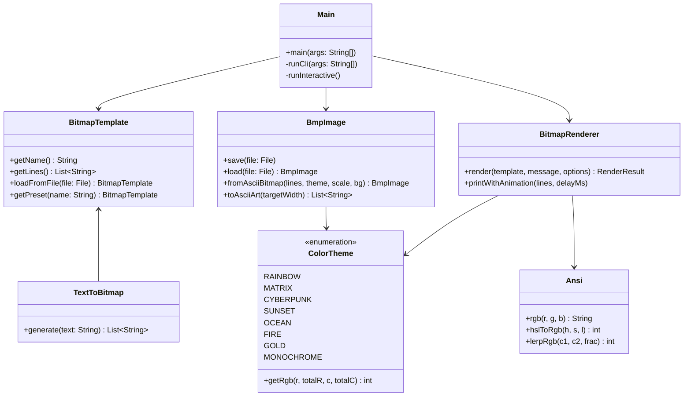

# 🖼️ Bitmap Program in Java

[](https://openjdk.org/)
[](LICENSE)
[](#-technologies--design)
[](#-testing)

A feature-packed, educational Java implementation of a **Bitmap Program**. This project brings together the artistic text-filling magic of **Al Sweigart's classic "Bitmap Message"** (*The Big Book of Small Python Projects*, Project #3) and expands it into a **pure Java 24-bit Windows Bitmap (`.bmp`) binary encoder, decoder, and ASCII art processor**.

---

## 📑 Table of Contents

- [✨ Features](#-features)
- [🚀 Quick Start](#-quick-start)
- [🎮 Interactive Mode](#-interactive-mode)
- [💻 Command-Line Interface (CLI)](#-command-line-interface-cli)
- [🧩 Built-in Templates & Dynamic Text Art](#-built-in-templates--dynamic-text-art)
- [🎨 Color Themes](#-color-themes)
- [📐 Deep Dive: How the Windows BMP Format Works](#-deep-dive-how-the-windows-bmp-format-works)
- [🧮 Deep Dive: Modulo Wrapping Algorithms](#-deep-dive-modulo-wrapping-algorithms)
- [🏗️ Architecture & Class Structure](#️-architecture--class-structure)
- [🧪 Testing](#-testing)
- [💡 Concepts Learned](#-concepts-learned)

---

## ✨ Features

- **7 High-Definition Built-in Bitmap Presets**:
  - 🌍 `world`: Classic continental world map (*Sweigart's original bitmap*)
  - ☕ `coffee`: Steaming cup of Java espresso
  - ❤️ `heart`: Pixel heart with contouring
  - 💀 `skull`: Retro arcade skull
  - 👾 `alien`: 8-bit Space Invader sprite
  - 🐱 `cat`: Feline pixel silhouette
  - 🚀 `rocket`: Space exploration rocket with thruster flames
- **Dynamic Text-to-Bitmap Generator**: Turn any custom word or phrase (e.g. `JAVA`, `RETRO`, your name) into a 2D font matrix automatically, then fill it with custom text!
- **Pure Java 24-bit Windows BMP Encoder/Decoder**:
  - Export any rendered text bitmap into a high-res, crisp `.bmp` image file with customizable pixel scale.
  - Read and parse raw 24-bit uncompressed `.bmp` files from disk at byte level.
  - Convert any `.bmp` image back into terminal ASCII art using luminance mapping.
  - **Zero external libraries or third-party dependencies.**
- **Dual Wrapping Engines**:
  - `Column-Aligned (Sweigart Classic)`: Cycles characters using horizontal column indexing `message.charAt(col % len)`.
  - `Continuous Stream`: Flows characters sequentially across solid pixels row by row.
- **8 ANSI TrueColor Themes**:
  - 🌈 `Rainbow`, 🟢 `Matrix`, ⚡ `Cyberpunk`, 🌅 `Sunset`, 🌊 `Ocean`, 🔥 `Fire`, 🌟 `Gold`, and ⚪ `Monochrome`.
- **Animated Reveal Mode**: Typewriter / cascading stream animation with customizable milliseconds delay.
- **Invert Mode**: Flip solids and empty spaces to render negative-space art.
- **External File Loader**: Import custom `.txt` files containing any ASCII art or bitmap grid.

---

## 🚀 Quick Start

### Prerequisites

- **Java Development Kit (JDK 17 or higher, fully tested on JDK 25)**
- Bash shell (macOS, Linux, or WSL/Git Bash on Windows)

### 1. Run with Helper Script (Recommended)

The included `run.sh` script automatically detects your installed JDK, compiles the source into `bin/`, and launches the program:

```bash
# Launch interactive menu
./run.sh

# Or run with CLI options directly
./run.sh --preset coffee --message "JAVA 25" --color fire
```

### 2. Manual Compilation & Execution

```bash
# Compile
mkdir -p bin
javac -d bin src/bitmap/*.java

# Run interactive menu
java -cp bin bitmap.Main

# Run with flags
java -cp bin bitmap.Main --preset heart --message "LOVE" --color sunset
```

---

## 🎮 Interactive Mode

Running `./run.sh` without arguments launches the interactive console UI:

```text
  ____  _ _                          ____                                      
 | __ )(_) |_ _ __ ___   __ _ _ __  |  _ \ _ __ ___   __ _ _ __ __ _ _ __ ___  
 |  _ \| | __| '_ ` _ \ / _` | '_ \ | |_) | '__/ _ \ / _` | '__/ _` | '_ ` _ \ 
 | |_) | | |_| | | | | | (_| | |_) ||  __/| | | (_) | (_| | | | (_| | | | | | |
 |____/|_|\__|_| |_| |_|\__,_| .__/ |_|   |_|  \___/ \__, |_|  \__,_|_| |_| |_|
                             |_|                     |___/                     
                 Pure Java Bitmap Art & 24-bit BMP Generator (v1.0.0)

Choose a Bitmap Source:
  1) 🌍 Classic World Map (Sweigart)
  2) ☕ Steaming Java Coffee Cup
  3) ❤️ Pixel Heart
  4) 💀 Retro Arcade Skull
  5) 👾 8-Bit Space Invader Alien
  6) 🐱 Pixel Silhouette Cat
  7) 🚀 Space Exploration Rocket
  8) 🔤 Dynamic Word Banner (e.g. your name)
  9) 📂 Load Custom Template File (.txt)
 10) 🖼️  Convert BMP Image to ASCII (.bmp)
  0) 🚪 Exit Program
```

### Sample Output (Heart Preset with Continuous Stream)

```text
         LOVELOVEL               OVELOVELO         
      VELOVELOVELOVEL         OVELOVELOVELOVE      
    LOVELOVELOVELOVELOV     ELOVELOVELOVELOVELO    
   VELOVELOVELOVELOVELOV   ELOVELOVELOVELOVELOVE   
  LOVELOVELOVELOVELOVELOV ELOVELOVELOVELOVELOVELO  
  VELOVELOVELOVELOVELOVELOVELOVELOVELOVELOVELOVEL  
  OVELOVELOVELOVELOVELOVELOVELOVELOVELOVELOVELOVE  
  LOVELOVELOVELOVELOVELOVELOVELOVELOVELOVELOVELOV  
   ELOVELOVELOVELOVELOVELOVELOVELOVELOVELOVELOVE   
    LOVELOVELOVELOVELOVELOVELOVELOVELOVELOVELOV    
      ELOVELOVELOVELOVELOVELOVELOVELOVELOVELO      
        VELOVELOVELOVELOVELOVELOVELOVELOVEL        
          OVELOVELOVELOVELOVELOVELOVELOVE          
            LOVELOVELOVELOVELOVELOVELOV            
              ELOVELOVELOVELOVELOVELO              
                VELOVELOVELOVELOVEL                
                  OVELOVELOVELOVE                  
                    LOVELOVELOV                    
                      ELOVELO                      
                        VEL                        
                         O                         
```

---

## 💻 Command-Line Interface (CLI)

The program can be scripted or run non-interactively using CLI flags:

```bash
java -cp bin bitmap.Main [OPTIONS]
```

### CLI Flag Reference

| Flag | Long Option | Description | Default |
| :--- | :--- | :--- | :--- |
| `-p` | `--preset <name>` | Built-in preset (`world`, `coffee`, `heart`, `skull`, `alien`, `cat`, `rocket`) | `world` |
| `-m` | `--message <text>` | Text message used to fill the solid bitmap pixels | `"JAVA"` |
| `-c` | `--color <theme>` | Color theme (`rainbow`, `matrix`, `cyberpunk`, `sunset`, `ocean`, `fire`, `gold`, `mono`) | `rainbow` |
| `-t` | `--text <word>` | Generate a dynamic 2D banner bitmap from an input word | `none` |
| `-f` | `--file <path>` | Load external ASCII art or bitmap template from `.txt` file | `none` |
| `-e` | `--export <path>` | Export rendered bitmap to a 24-bit uncompressed `.bmp` file | `none` |
| `-i` | `--import-bmp <p>` | Load a 24-bit `.bmp` image from disk and render as ASCII art | `none` |
| `-a` | `--animate [ms]` | Animate line-by-line reveal (default: 40ms per line) | `0` (off) |
| | `--mode <mode>` | Wrapping mode: `column` (Sweigart classic) or `stream` (sequential) | `column` |
| | `--invert` | Invert solid and empty pixels | `false` |
| | `--scale <px>` | Pixel block scale for BMP export (e.g. 8 = 8x8 px per char) | `8` |
| | `--no-color` | Disable ANSI TrueColor codes (plain text output) | `false` |
| `-l` | `--list` | List all built-in presets and color themes | |
| `-h` | `--help` | Display manual and CLI usage | |

### CLI Examples

```bash
# 1. Classic Sweigart World Map with Rainbow colors
./run.sh --preset world --message "HELLO WORLD" --color rainbow

# 2. Coffee Cup with Fire theme in continuous stream mode
./run.sh --preset coffee --message "JAVA ESPRESSO" --color fire --mode stream

# 3. Dynamic Word Banner exported directly to a high-res BMP image
./run.sh --text "JAVA" --message "CODE" --color cyberpunk --export java_art.bmp

# 4. Animated Alien reveal with Matrix green styling
./run.sh --preset alien --message "INVADERS" --color matrix --animate 50

# 5. Load and convert a BMP image into ASCII art in the terminal
./run.sh --import-bmp java_art.bmp
```

---

## 🧩 Built-in Templates & Dynamic Text Art

All templates are embedded directly in code and also mirrored in the `templates/` directory:

| Preset Key | Description | Dimensions | Solid Pixels |
| :--- | :--- | :---: | :---: |
| `world` | Al Sweigart's classic global continents map | 68 × 21 | 632 |
| `coffee` | Steaming Java coffee cup with saucer & handle | 44 × 18 | 328 |
| `heart` | Pixel heart silhouette | 51 × 21 | 487 |
| `skull` | Retro arcade pirate skull with eye sockets | 36 × 21 | 425 |
| `alien` | 8-bit classic Space Invader sprite | 32 × 11 | 148 |
| `cat` | Cute pixel cat silhouette | 28 × 21 | 308 |
| `rocket` | Retro space rocket launching with booster exhaust | 28 × 29 | 240 |

### Dynamic Text-to-Bitmap (`TextToBitmap.java`)

Using an internal 5×7 bitmap font matrix, the program can convert any arbitrary alphanumeric text into a multi-row banner grid:

```text
Input: "JAVA"
Generated Bitmap Matrix:
  *****   ***   *   *   ***  
    *    *   *  *   *  *   * 
    *    *   *  *   *  *   * 
    *    *****  *   *  ***** 
*   *    *   *   * *   *   * 
*   *    *   *   * *   *   * 
 ***     *   *    *    *   * 
```

This matrix can then be filled with another message or saved as a `.bmp` image!

---

## 🎨 Color Themes

The styling engine uses standard 24-bit ANSI TrueColor sequences (`\u001b[38;2;R;G;Bm`):

| Theme | Palette Description | Color Progression |
| :--- | :--- | :--- |
| `rainbow` | Continuous HSL color wheel | Red $\rightarrow$ Yellow $\rightarrow$ Green $\rightarrow$ Cyan $\rightarrow$ Blue $\rightarrow$ Magenta |
| `matrix` | Phosphor CRT terminal | Fluorescent green highlight $\rightarrow$ Deep phosphor green |
| `cyberpunk` | Synthwave aesthetic | Electric Neon Cyan $\rightarrow$ Hot Pink $\rightarrow$ Violet |
| `sunset` | Golden hour glow | Warm Gold $\rightarrow$ Fiery Coral $\rightarrow$ Deep Purple |
| `ocean` | Deep sea marine tones | Aquamarine $\rightarrow$ Sky Blue $\rightarrow$ Deep Navy |
| `fire` | Blazing flame heat | Pale Lemon Yellow $\rightarrow$ Tangerine Orange $\rightarrow$ Dark Crimson |
| `gold` | Polished metallic gradient | Brilliant Champagne Gold $\rightarrow$ Amber $\rightarrow$ Bronze |
| `mono` | High contrast text | Pure terminal monochrome white |

---

## 📐 Deep Dive: How the Windows BMP Format Works

A standard Windows Bitmap (`.bmp`) file is a binary image format consisting of two header structures followed by a 2D pixel array:

```
+-------------------------------------------------------------+
| BITMAPFILEHEADER (14 bytes)                                 |
| - Magic identifier: 'B', 'M' (0x4D42)                       |
| - File size in bytes (32-bit LE)                            |
| - Reserved fields (4 bytes = 0)                             |
| - Pixel array offset: 54 bytes (32-bit LE)                  |
+-------------------------------------------------------------+
| BITMAPINFOHEADER (40 bytes)                                 |
| - Header size: 40 bytes (0x28)                              |
| - Image Width (32-bit LE)                                   |
| - Image Height (32-bit LE, positive = bottom-up scanlines)  |
| - Color Planes: 1 (16-bit LE)                               |
| - Bits Per Pixel: 24 (16-bit LE, 3 bytes per pixel: BGR)    |
| - Compression: 0 (BI_RGB uncompressed)                      |
| - Image data size in bytes                                  |
| - Target resolution (2835 pixels/meter ≈ 72 DPI)            |
+-------------------------------------------------------------+
| PIXEL ARRAY (Bottom-up scanlines with 4-byte row padding)    |
| - Scanline 0 (Bottom row of image): B, G, R, [padding]      |
| - Scanline 1:                       B, G, R, [padding]      |
| ...                                                         |
| - Scanline H-1 (Top row of image):  B, G, R, [padding]      |
+-------------------------------------------------------------+
```

### The 4-Byte Row Padding Rule

In the BMP specification, each row in the pixel array **must be padded with null bytes (`0x00`) to a multiple of 4 bytes**. 

For a 24-bit image, each pixel takes 3 bytes (Blue, Green, Red). The padding formula implemented in [`BmpImage.java`](file:///Users/infinity/Documents/Java-Learn/Small-Java-Projects/Bitmap/src/bitmap/BmpImage.java) is:

$$\text{padding} = (4 - (\text{width} \times 3) \bmod 4) \bmod 4$$

$$\text{rowStride} = (\text{width} \times 3) + \text{padding}$$

| Width (px) | Raw Row Bytes ($W \times 3$) | Padding Bytes | Stride (Bytes) |
| :---: | :---: | :---: | :---: |
| 1 | 3 | **1** | 4 |
| 2 | 6 | **2** | 8 |
| 3 | 9 | **3** | 12 |
| 4 | 12 | **0** | 12 |
| 5 | 15 | **1** | 16 |

### Scanline Direction and Byte Order

1. **BGR Byte Sequence**: Unlike web standard RGB, BMP stores color channels in reverse order: **Blue, Green, Red**.
2. **Bottom-Up Scanlines**: A positive `biHeight` indicates that row 0 in the file is the **bottom** row of the image.

---

## 🧮 Deep Dive: Modulo Wrapping Algorithms

### 1. Column-Aligned Wrapping (Sweigart's Classic)

In this mode, the character printed at column $c$ depends exclusively on the horizontal position:

$$\text{charIndex} = c \bmod \text{message.length()}$$

```java
for (int c = 0; c < line.length(); c++) {
    if (line.charAt(c) != ' ') {
        char ch = message.charAt(c % message.length());
        System.out.print(ch);
    } else {
        System.out.print(' ');
    }
}
```

*Effect*: Creates consistent vertical stripes of repeated letters across the entire height of the shape.

### 2. Continuous Flow Wrapping

In this mode, a running index increments every time a solid pixel is encountered:

$$\text{charIndex} = (\text{streamIndex}++) \bmod \text{message.length()}$$

*Effect*: Words flow smoothly across the shape like reading a book from top-to-bottom, left-to-right.

---

## 🏗️ Architecture & Class Structure

```text
Bitmap/
├── .gitignore               # Ignores build artifacts, IDE files, and generated BMPs
├── README.md                # Documentation and guide
├── run.sh                   # JDK detection and execution script
├── test.sh                  # Automated zero-dependency test runner
├── templates/               # External sample ASCII art templates
│   ├── world.txt
│   ├── coffee.txt
│   ├── heart.txt
│   ├── skull.txt
│   ├── alien.txt
│   ├── cat.txt
│   └── rocket.txt
├── src/
│   └── bitmap/
│       ├── Main.java           # Application entry point, CLI & interactive controller
│       ├── Ansi.java           # ANSI formatting, 24-bit TrueColor, RGB interpolation
│       ├── ColorTheme.java     # Color themes & dynamic 2D gradient generator
│       ├── BitmapTemplate.java # Preset registry, metadata, and .txt file loader
│       ├── BitmapRenderer.java # Core rendering engine, modulo wrapping, animation
│       ├── TextToBitmap.java   # 5x7 bitmap font vectorizer for custom words
│       └── BmpImage.java       # Pure Java 24-bit Windows BMP encoder/decoder
└── test/
    └── bitmap/
        └── BitmapTest.java     # Comprehensive 470-assertion unit test suite
```



---

## 🧪 Testing

The project includes a **zero-dependency unit test suite** covering:

- Preset registration, dimension bounds, and non-empty pixel checks
- Modulo column-aligned character mapping verification
- Continuous stream sequential flow verification
- Inverted rendering mode correctness
- Color theme gradient math across 2D boundaries (valid $[0, 2^{24}-1]$ range)
- Dynamic 5×7 font generation row structure
- Windows BMP 4-byte row padding calculations across various pixel widths
- Full roundtrip BMP file serialization and deserialization (verifying byte offset, headers, and pixel fidelity)
- ASCII-to-BMP rasterization and BMP-to-ASCII luminance ramp mapping

### Running the Tests

Execute `test.sh`:

```bash
./test.sh
```

**Test Output:**

```text
Running Bitmap Program Test Suite...

  ✓ PASS: Presets map should not be empty
  ✓ PASS: Preset 'world' should exist
  ...
  ✓ PASS: BMP file was written to disk
  ✓ PASS: Loaded width matches
  ✓ PASS: Loaded height matches
  ✓ PASS: Pixel (0,0) Red
  ✓ PASS: Pixel (w-1,0) Green
  ✓ PASS: Pixel (0,h-1) Blue
  ✓ PASS: Pixel (w-1,h-1) Yellow
  ✓ PASS: Pixel (2,3) Center Magenta

=============================================
Test Results: 470 run, 470 passed, 0 failed.
=============================================
ALL TESTS PASSED SUCCESSFULLY! ✓
```

---

## 💡 Concepts Learned

Working on this project reinforces foundational and intermediate Java programming concepts:

1. **Binary I/O and Serialization**: Working with `BufferedInputStream` and `BufferedOutputStream` to read and write little-endian binary file headers at byte level without third-party frameworks.
2. **Bitwise Operations**: Masking and shifting (`>> 16`, `>> 8`, `& 0xFF`, `|`) to unpack and pack 24-bit RGB values and endianness.
3. **Modular Arithmetic**: Leveraging `%` for cyclic string wrapping over irregular 2D boundaries.
4. **2D Data Structures & Grids**: Managing coordinate systems, aspect ratios, character matrix rows, and image scanlines.
5. **ANSI Terminal Graphics**: Formatting terminal outputs using 24-bit TrueColor sequences and linear interpolation (`lerp`).
6. **Object-Oriented Design**: Clean separation of concerns between data templates, rendering engines, binary decoders, and user interfaces.

---

⭐ *Part of the [Small Java Projects](https://github.com/INFINITY-R13/Small-Java-Projects) collection — learning Java one project at a time.*
